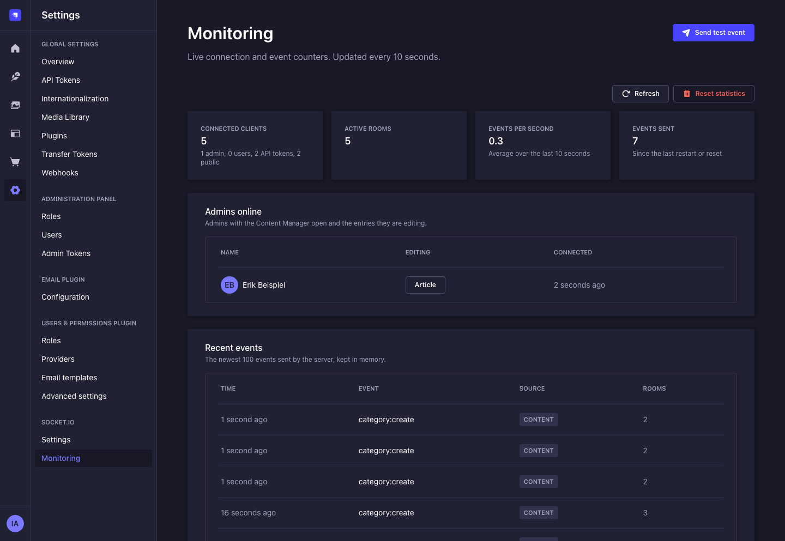
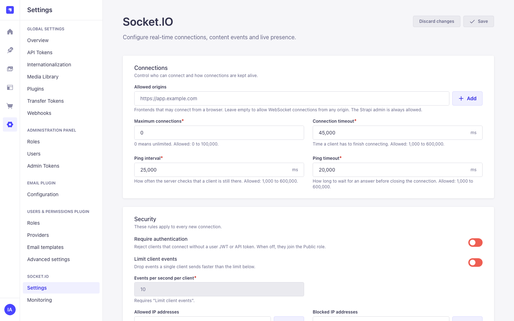
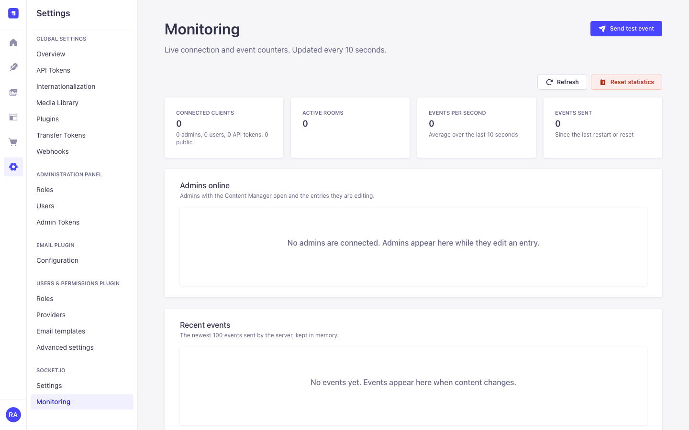
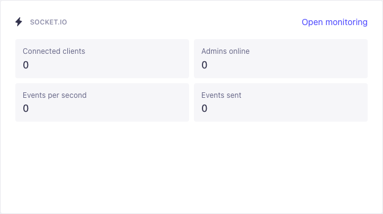
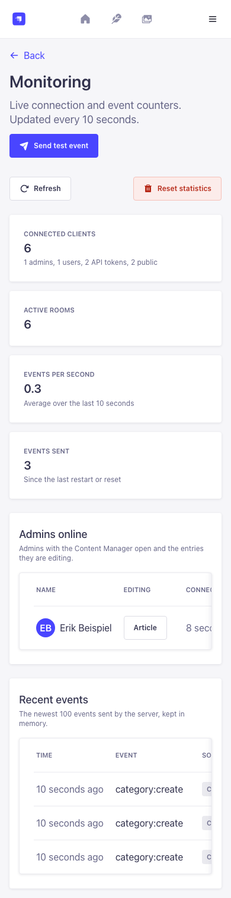
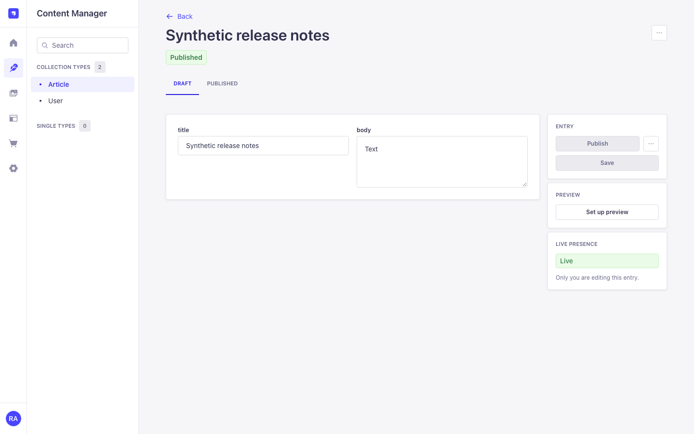

# @strapi-community/plugin-io

> Real-time content events for Strapi 5 with Socket.IO, scoped by Strapi's own permissions.

[](https://www.npmjs.com/package/@strapi-community/plugin-io)
[](https://www.npmjs.com/package/@strapi-community/plugin-io)
[](https://github.com/strapi-community/plugin-io/blob/main/LICENSE)
[](https://github.com/strapi-community/plugin-io/actions/workflows/ci.yml)
[](https://strapi.io)

The plugin attaches a Socket.IO server to Strapi's HTTP server and sends an event whenever a watched document is created, updated, published, unpublished, has its draft discarded or is deleted. Each client receives only what its role or API token may read through the REST API, sanitized with the same Content API sanitizer Strapi uses.

It also adds _Settings > Socket.IO_ (settings and live monitoring), two homepage widgets and a live presence panel in the Content Manager, all built from the Strapi Design System.



Full documentation: <https://strapi-community.github.io/plugin-io/>

## Contents

- [Requirements](#requirements)
- [Quick start](#quick-start)
- [Content events](#content-events)
- [Authentication](#authentication)
- [Configuration](#configuration)
- [Admin panel](#admin-panel)
- [Server API](#server-api)
- [Security model](#security-model)
- [Performance](#performance)
- [Scaling with Redis](#scaling-with-redis)
- [Upgrading from 5.x](#upgrading-from-5x)
- [Troubleshooting](#troubleshooting)
- [Development](#development)
- [Contributing](#contributing)

## Requirements

|                     | Version                                                  |
| ------------------- | -------------------------------------------------------- |
| Strapi              | 5.13 or later (tested with 5.61)                         |
| Node.js             | 22.21+ or 24.9+ (up to 26, like Strapi 5.61)             |
| Users & Permissions | Optional. Needed for user JWTs and the Public role room. |

## Quick start

```bash
npm install @strapi-community/plugin-io
```

`config/plugins.js`:

```js
module.exports = {
  io: {
    enabled: true,
    config: {
      contentTypes: ['api::article.article'],
    },
  },
};
```

Give the Public role (or any role) the **find** permission for Article in _Settings > Users & Permissions > Roles_, then connect from a frontend:

```js
import { io } from 'socket.io-client';

const socket = io('https://cms.example.com');

socket.on('article:publish', ({ data }) => console.log('Published', data.attributes.title));
socket.on('article:delete', ({ data }) => console.log('Deleted', data.documentId, data.locale));
```

Browsers on another origin must be listed under _Settings > Socket.IO > Settings > Allowed origins_. With an empty list only the Strapi host itself and the origins of `server.url` / `admin.url` may connect, for polling and WebSocket alike. Node scripts and mobile apps send no `Origin` header and are not affected.

## Content events

Events are named `<singularName>:<action>`. Content types are watched from the config (fixed) or chosen in the admin settings (editable).

| Action         | When                                      | Payload                              |
| -------------- | ----------------------------------------- | ------------------------------------ |
| `create`       | A document is created                     | `{ data: { id, attributes }, meta }` |
| `update`       | A document is updated                     | `{ data: { id, attributes }, meta }` |
| `publish`      | A draft is published                      | `{ data: { id, attributes }, meta }` |
| `discardDraft` | A draft is reset to the published version | `{ data: { id, attributes }, meta }` |
| `unpublish`    | A document is unpublished                 | `{ data: { documentId, locale? } }`  |
| `delete`       | A document (locale) is deleted            | `{ data: { documentId, locale? } }`  |

- **Who receives an event:** every Users & Permissions role and content API token with `find` or `findOne` permission on the content type. Read-only and full-access tokens receive all events. Roles that may only create or update receive nothing.
- **Drafts:** with Draft & Publish, draft versions are not sent while _Only published content_ is on (the default). Turn it off to send drafts to the roles that may read them.
- **Locales:** one event per locale. Events are emitted after the database transaction commits.
- **Populate:** `populate` refetches the entry with the same locale and status before it is sent.
- **Sanitizing:** each audience gets the entry sanitized with its own permissions. Private fields, password fields, built-in secrets (`password`, `resetPasswordToken`, `apiKey`, `secret`, ...), `config.sensitiveFields` and the _Excluded fields_ setting are removed. If sanitizing fails, that audience is skipped and nothing is sent.

Events come from Strapi's Document Service middleware (`strapi.documents.use`). Writes made directly with `strapi.db.query()` do not emit events.

## Authentication

Clients authenticate in the Socket.IO handshake:

```js
// Users & Permissions JWT (legacy and refresh mode)
io(url, { auth: { strategy: 'jwt', token: userJwt } });

// Content API token
io(url, { auth: { strategy: 'api-token', token: apiToken } });

// No token: the client joins the Public role (unless "Require authentication" is on)
io(url);
```

| Strategy                               | Room                                                | Notes                                                                                                                                                                                               |
| -------------------------------------- | --------------------------------------------------- | --------------------------------------------------------------------------------------------------------------------------------------------------------------------------------------------------- |
| `jwt`                                  | `io-role-<role type>`, e.g. `io-role-authenticated` | Blocked and unconfirmed users are rejected. The socket is disconnected when the JWT expires, the user is blocked or changes role, or (refresh mode) the Strapi session behind the token is revoked. |
| `api-token` (also `apiToken`, `token`) | `io-token-<token id>`                               | Content API tokens only; admin tokens are rejected. Disconnected when the token is deleted or expires.                                                                                              |
| none                                   | `io-role-public`                                    | Only while _Require authentication_ is off.                                                                                                                                                         |

Failed handshakes return one generic message (`Authentication failed`). After 20 failures from the same IP within a minute, that IP is locked out for the rest of the minute. The client IP follows Strapi's `server.proxy` settings.

For refresh-mode JWTs, pass a function so that reconnects use a fresh access token:

```js
io(url, { auth: (cb) => getAccessToken().then((token) => cb({ strategy: 'jwt', token })) });
```

The handshake stores the client on `socket.data`. Check `socket.data.kind` before you trust an id:

| `kind`   | Keys                                                                        |
| -------- | --------------------------------------------------------------------------- |
| `public` | `role`                                                                      |
| `user`   | `user.id`, `user.role`, `role`, `expiresAt` (Users & Permissions user)      |
| `token`  | `token.id`, `token.type`, `expiresAt`                                       |
| `admin`  | `admin.id`, `admin.firstname`, `admin.lastname` (presence panel, admin ids) |

Admin presence sockets never carry `socket.data.user`, and `config.events` handlers skip them unless the event sets `admin: true`.

## Configuration

```js
// config/plugins.js
module.exports = ({ env }) => ({
  io: {
    enabled: true,
    config: {
      // Fixed watch list. Strings watch every action.
      contentTypes: [
        'api::article.article',
        { uid: 'api::page.page', actions: ['publish', 'unpublish', 'delete'], populate: ['seo', 'cover'] },
      ],

      // Extra field names that are never sent.
      sensitiveFields: ['internalNotes'],

      // Custom client events. Handlers get ({ strapi, io }, socket, ...args).
      // Admin presence sockets are skipped unless an event sets `admin: true`.
      events: [
        { name: 'connection', handler: ({ strapi }, socket) => strapi.log.debug(`[io] ${socket.data.kind} connected`) },
        { name: 'ping', handler: (_ctx, socket) => socket.emit('pong') },
      ],

      // Runs once during bootstrap (awaited), before the plugin handshake is added.
      // `$io` and `io` are the same object. Use it for adapters, middleware or namespaces.
      hooks: {
        async init({ strapi, $io }) {},
      },

      // Socket.IO server options. Values here win over the admin settings.
      socket: {
        serverOptions: {
          // cors: { origin: ['https://app.example.com'] },
          // maxHttpBufferSize: 1e6,
        },
      },
    },
  },
});
```

Defaults the plugin sets unless you override them in `socket.serverOptions`:

| Option                                          | Default                 | Why                                                                                                                                                                        |
| ----------------------------------------------- | ----------------------- | -------------------------------------------------------------------------------------------------------------------------------------------------------------------------- |
| `destroyUpgrade`                                | `false`                 | Foreign upgrades (Strapi Data Transfer) are forwarded to Strapi instead of being closed.                                                                                   |
| `maxHttpBufferSize`                             | `1e5` (100 KB)          | Limits the size of messages clients send. Socket.IO's default is 1 MB.                                                                                                     |
| `cors` / `allowRequest`                         | from _Allowed origins_  | Applies the same origin rule to polling and WebSocket. Same-origin requests, `server.url` / `admin.url` origins and clients without an `Origin` header are always allowed. |
| `pingInterval`, `pingTimeout`, `connectTimeout` | from the admin settings | Applied to new connections without a restart.                                                                                                                              |

## Admin panel

The plugin adds a **Socket.IO** section under _Settings_ with two pages, two homepage widgets and a side panel in the Content Manager. All screens use the Strapi Design System and follow the layout of the native settings pages.



**Settings** (`plugin::io.settings.read` / `plugin::io.settings.update`). Every setting applies to new connections without a restart:

| Section             | Settings                                                                                                                                           |
| ------------------- | -------------------------------------------------------------------------------------------------------------------------------------------------- |
| Connections         | Allowed origins, maximum connections (0 = unlimited), ping interval, ping timeout, connection timeout                                              |
| Security            | Require authentication, limit client events (events per second per client), allowed IP addresses, blocked IP addresses (addresses and CIDR blocks) |
| Content events      | Only published content, excluded fields, actions per content type (rows set in the config are read-only)                                           |
| Roles               | Whether each Users & Permissions role may connect. What a role receives follows its permissions.                                                   |
| Entry subscriptions | Allow `subscribe-entity`, subscriptions per client (off by default)                                                                                |
| Live presence       | Show who is editing, show typing                                                                                                                   |
| Monitoring          | Log connections, keep an in-memory event log, event log size                                                                                       |
| Export and import   | Download the saved settings as JSON (no secrets); import a file, review the changed values and save                                                |

Import sends the file to `POST /io/settings/validate` (needs `plugin::io.settings.update`), which checks it with the same strict schema as _Save_ and stores nothing. The changed values are listed in a confirmation dialog and replace the form values; _Save_ stores them.

**Monitoring** (`plugin::io.monitoring.read`; reset and test events need `plugin::io.monitoring.manage`): connected clients by type, active rooms, events per second, events sent, admins online with the entries they edit, and the event log. Entries in content types the viewer may not read in the Content Manager are counted, not named. Test events go to every connected client; names used by content and presence events are refused.



**Homepage widgets** (Strapi 5.13+): _Socket.IO_ (four counters) and _Admins online_. Both need `plugin::io.monitoring.read`.





**Live presence panel** in the Content Manager edit view: shows the other admins editing the same entry and, optionally, which field they are typing in. Admins only join the presence room of content types they may read in the Content Manager. The panel connects with a one-time token per connection attempt (at most five unused tokens per admin) and shows no email addresses. The connection ends when the admin logs out, the admin session expires or the account is deactivated.



Screenshots come from a local test host with synthetic data.

Strapi grants new permissions to Super Admins only. Give other roles access in _Settings > Administration Panel > Roles > Plugins > IO_.

## Server API

```js
// Content events (also used internally)
await strapi.$io.emit({ event: 'publish', schema: 'api::article.article', data: entry });
await strapi.$io.emitIdentifier({ event: 'delete', schema: 'api::article.article', data: { documentId, locale } });

// Custom events (sensitive fields removed). Without rooms they go to every client.
await strapi.$io.raw({ event: 'maintenance', data: { at: '22:00' }, rooms: ['io-role-authenticated'] });

// Helpers
strapi.$io.joinRoom(socketId, 'premium'); // plugin rooms (io-role-, io-token-, io-admin-, io-entity-, presence:) are refused
strapi.$io.leaveRoom(socketId, 'premium');
await strapi.$io.getSocketsInRoom('premium');
strapi.$io.sendPrivateMessage(socketId, 'notice', data);
strapi.$io.broadcast(socketId, 'notice', data); // everyone except socketId
strapi.$io.emitToNamespace('chat', 'notice', data);
strapi.$io.disconnectSocket(socketId);
await strapi.$io.subscribeToEntity(socketId, 'api::article.article', documentId); // same checks as subscribe-entity
strapi.$io.unsubscribeFromEntity(socketId, 'api::article.article', documentId);
strapi.$io.getEntitySubscriptions(socketId);
await strapi.$io.revalidateSockets(); // every authenticated socket
await strapi.$io.revalidateSockets(['user'], { ids: [userId] }); // only this user's sockets

strapi.$io.server; // the Socket.IO Server
strapi.$io.namespaces; // { '': Namespace, chat: Namespace, ... }

// Monitoring service (counts only)
const monitoring = strapi.plugin('io').service('monitoring');
await monitoring.getConnectionStats(); // { connected, rooms, byKind: { admin, user, token, public } }
monitoring.getEventStats(); // { totalEvents, eventsPerSecond, lastEventAt, totalConnections, since }
monitoring.getEventLog(50);
```

**Entity subscriptions.** With _Entry subscriptions_ on, clients follow single entries:

```js
socket.emit('subscribe-entity', { uid: 'api::article.article', documentId }, (reply) => {
  // { success: true, uid, documentId, id } or { success: false, error }
});
socket.on('article:update', ({ data }) => render(data.attributes));
socket.emit('unsubscribe-entity', { uid: 'api::article.article', documentId });
```

A subscription needs `find` or `findOne` on the client's own role or API token and an existing entry. Every event is sanitized with those permissions, and read permission is checked again for each event. Subscribers also receive events of content types and actions that are not broadcast under _Events_, and a client in both its role room and an entry room gets each event once. Admin sockets cannot subscribe. The [IO class reference](https://strapi-community.github.io/plugin-io/api/io-class#entity-subscriptions) lists the errors.

Namespaces created with `strapi.$io.server.of('/name')`, for example in `hooks.init`, use the same handshake as the default namespace. TypeScript types ship with the package (`types.d.ts`) and add `strapi.$io` to `Core.Strapi`.

## Security model

- Admin routes require an authenticated admin plus the plugin permission (`admin::hasPermissions`). The presence session route only requires an authenticated admin; it keeps at most five unused tokens per admin and answers `429` when 10,000 are pending. A token holds the admin id and session id only; permissions are loaded from the database when it is used.
- Monitoring responses contain counts and admin display names only, never IP addresses, emails, tokens or socket ids.
- The settings document is validated with a strict schema (unknown keys rejected, every list and number bounded). Invalid input returns `400` with field paths.
- Entity subscriptions need read permission of the client's role or API token, are limited per client and to ten requests per second, use reserved per-audience rooms and are re-checked on every event.
- Presence events are accepted only from admin sockets, need Content Manager read permission for the content type and are rate limited. Admin sockets are re-checked against the admin's current permissions and Strapi session.
- Browser origins are checked for polling and WebSocket. An empty _Allowed origins_ list means same origin only.
- Clients can be rate limited per socket; the connection count, IP rules and origins are checked in the handshake.
- Logs never contain tokens, emails or IP addresses.

Report vulnerabilities privately through GitHub security advisories.

`npm audit --omit=dev` reports 0 vulnerabilities for the published package. The development tree overrides `nodemailer`, the `zod` of `koa-body` and `@hono/node-server` to patched releases. The advisories left in it (`zod` 3 inside `koa-session`, `stream-json`, `react-router` 6, `minimatch`/`glob` in build tools, `deepmerge`) have no compatible fix and are not shipped with the plugin; the [migration guide](https://strapi-community.github.io/plugin-io/guide/migration#dependency-advisories-development-tree) lists each one and why it stays.

## Performance

- **Delivery:** one sanitize pass per room that has listeners. Rooms without sockets are skipped (with the in-memory adapter), so hundreds of API tokens cost nothing until they connect. On the 5,000-article test host a publish with populated relations adds 10 queries for the plugin (one refetch plus an occasional audience-cache rebuild), independent of the number of roles and tokens.
- **Audience cache:** roles, tokens and their permissions are loaded with one query per kind and cached for 10 seconds; role, permission and token changes clear the cache.
- **Re-checks:** every five minutes and right after a user, admin, API token or Strapi session changes. Checks run in one batch per kind: one query for all affected users, one for tokens, one for admins, plus one per distinct session. On a test host with 200 connected sockets, updating an unrelated user cost 427 SQL queries before this targeting existed; now the plugin adds none (the update itself takes Strapi 22 to 27 queries).
- **Populate:** only what you configure, refetched once per event.
- **Memory:** presence tokens are capped per admin and globally; monitoring keeps fixed-size counters and a bounded event log.

## Scaling with Redis

To run several Strapi instances behind a load balancer, use the official Redis adapter. Install `@socket.io/redis-adapter` and `redis` in your project and attach the adapter in `hooks.init`:

```js
const { createAdapter } = require('@socket.io/redis-adapter');
const { createClient } = require('redis');

module.exports = ({ env }) => ({
  io: {
    enabled: true,
    config: {
      contentTypes: ['api::article.article'],
      hooks: {
        async init({ strapi, $io }) {
          const pubClient = createClient({ url: env('REDIS_URL') });
          const subClient = pubClient.duplicate();
          await Promise.all([pubClient.connect(), subClient.connect()]);
          $io.server.adapter(createAdapter(pubClient, subClient));
          strapi.log.info('[io] Redis adapter ready');
        },
      },
    },
  },
});
```

Keep the Redis URL in an environment variable. The admin panel does not store it.

With an adapter that spans several servers, a server cannot see which entries are followed on the other servers. While _Entry subscriptions_ is on, every change to a content type that is not broadcast is therefore sanitized and sent to the entry rooms of each reading audience (Redis delivers it only where subscribers exist). Leave _Entry subscriptions_ off if you do not use them.

## Upgrading from 5.x

6.0 contains breaking changes. The full list is in [CHANGELOG.md](./CHANGELOG.md). In short:

1. **Delivery follows read permissions.** Give roles and tokens `find` (or `findOne`) on the content types they should receive. Create or update permissions alone no longer deliver events.
2. **Publish is its own event.** Publishing used to emit `:delete` and `:create`; it now emits `:publish`. Unpublish and discard draft emit `:unpublish` and `:discardDraft`. If you limit `actions` in the config, add the new ones you need.
3. **Drafts are not sent by default.** Turn off _Only published content_ to send drafts.
4. **Delete events go to readers only** and include `locale` for localized content.
5. **Rooms:** API-token rooms are `io-token-<id>`; custom role rooms are `io-role-<role type>` (`io-role-public` and `io-role-authenticated` are unchanged).
6. **Settings are enforced.** Settings stored by 5.x were never applied. On the first start, unused keys (Redis, namespaces, live preview, field-level changes) are dropped, entity subscriptions stay off until you turn them on, and the old default origin `http://localhost:3000` and the old default connection limit of 1000 are reset. Review _Settings > Socket.IO_ after upgrading.
7. **Admin permissions.** Only Super Admins can open the plugin pages until you grant the new permissions to other roles.
8. **Removed:** the `security` service, the scaffold route `GET /api/io`, live preview field events and field-level diffs (the migration guide explains why). **Restored:** entity subscriptions (with permission checks, off by default; clients pass the `documentId`) and settings export and import.
9. **Message size.** `maxHttpBufferSize` defaults to 100 KB. Raise it in `socket.serverOptions` if clients send larger messages.
10. **Allowed origins apply to WebSocket too.** 5.x accepted WebSocket clients from any origin. With an empty list only same-origin browsers (plus `server.url` / `admin.url`) may connect; list your frontends.
11. **Admin sockets use `socket.data.admin`.** Presence sockets no longer appear as `socket.data.user`, and `config.events` handlers skip them unless the event sets `admin: true`.
12. **Node.js 22.21+ or 24.9+** is required.
13. **`hooks.init`** receives `{ strapi, $io, io }` and runs before the plugin handshake, as in 5.x. Middleware added there runs before authentication.

The [migration guide](https://strapi-community.github.io/plugin-io/guide/migration) explains each step with code.

## Troubleshooting

**`strapi transfer` fails with 504 or 524 behind a proxy (#112).** Socket.IO's upgrade listener stopped Node from passing the Data Transfer WebSocket to Strapi. The plugin tells Node (`shouldUpgradeCallback`, Node 22.21+ / 24.9+) to accept upgrades only on the Socket.IO path, so every other request, including a `POST` with an `Upgrade: h2c` header and a body, reaches Strapi exactly as without the plugin. If you attach your own `upgrade` listener, the plugin leaves those upgrades to you. On an older, unsupported Node.js the plugin logs a warning at startup.

**`strapi ts:generate-types` or shutdown hangs (#109).** The plugin no longer closes Strapi's HTTP server, and all its timers are released on destroy.

**Clients receive nothing.** Check that the role or token has `find` on the content type, that the content type is watched (config or settings) and, for Draft & Publish, that you listen to `:publish` or turned off _Only published content_.

**Browser connection fails with a CORS, 400 or 403 error.** Add the frontend origin under _Allowed origins_, or set `socket.serverOptions.cors` and `allowRequest`.

**A custom handler sees `socket.data.user` as undefined.** The client is an admin presence socket or a public/token client. Check `socket.data.kind`.

**`hooks.init failed` in the log.** The hook threw; Strapi started without what it sets up (for example the Redis adapter). Fix the error shown in the log.

## Development

```bash
npm ci
npm run lint          # ESLint 10 flat config
npm run format:check  # Prettier
npm run build         # @strapi/sdk-plugin
npm test              # node --test
npm run test:types    # checks types.d.ts with tsc
npm run test:e2e      # e2e suites against a running Strapi app (see below)
npm run test:e2e:app  # scaffolds a Strapi 5.61 app with the packed plugin and runs the e2e suites (as CI does)
npm run verify
```

`npm run test:e2e` runs the admin regression suite (Settings form, unsaved-changes guard, export and import, Monitoring, homepage widgets, 390 px and dark mode, read-only RBAC) in a standalone Chromium and the socket/API suite (per-audience delivery, entity subscriptions, settings import check, #112 upgrades, `Upgrade: h2c` bodies). Point it at a Strapi app with the plugin installed: `IO_E2E_URL=http://127.0.0.1:1337 IO_E2E_EMAIL=... IO_E2E_PASSWORD=... IO_E2E_TOKEN=<full-access API token> npm run test:e2e` (optionally `IO_E2E_VIEWER_EMAIL` / `IO_E2E_VIEWER_PASSWORD` for an admin with read-only plugin permissions). Run `npx playwright install chromium` once. Without these variables the tests are skipped.

`npm run build && npm run test:e2e:app` does all of that for you: it scaffolds a Strapi 5.61 app outside the repository (SQLite, the synthetic content types in `tests/e2e/app`, loopback-only egress), installs the packed plugin, seeds admins and a token with random per-run secrets that are never printed, and runs both suites. Options: `--port` (default 1357), `--dir`, `--overrides` (apply this repo's npm overrides to the app) and `--keep`. CI runs it on Node 22 and 24.

Commits follow [Conventional Commits](https://www.conventionalcommits.org/). semantic-release publishes releases from `main` and folds the `[Unreleased]` section of `CHANGELOG.md` into the release notes (`scripts/release-unreleased.mjs`).

## Contributing

Bug reports and pull requests are welcome. Please open an [issue](https://github.com/strapi-community/plugin-io/issues) first for larger changes, run `npm run lint`, `npm run format:check` and `npm test` before you push, and add a test for every fix.

## License

[MIT](./LICENSE)
